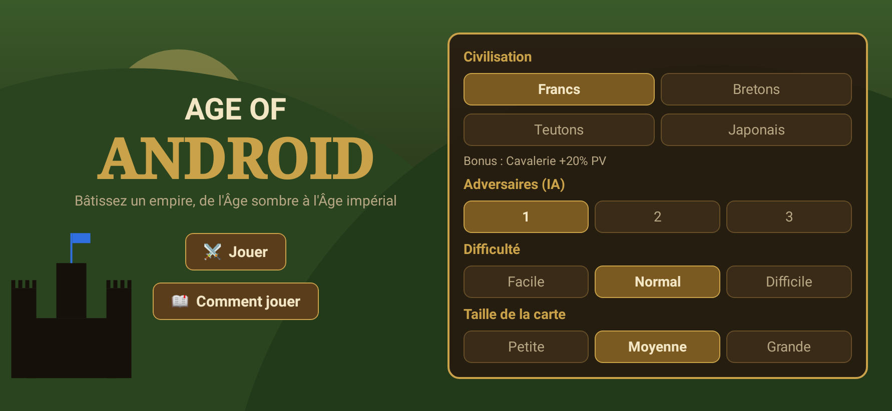
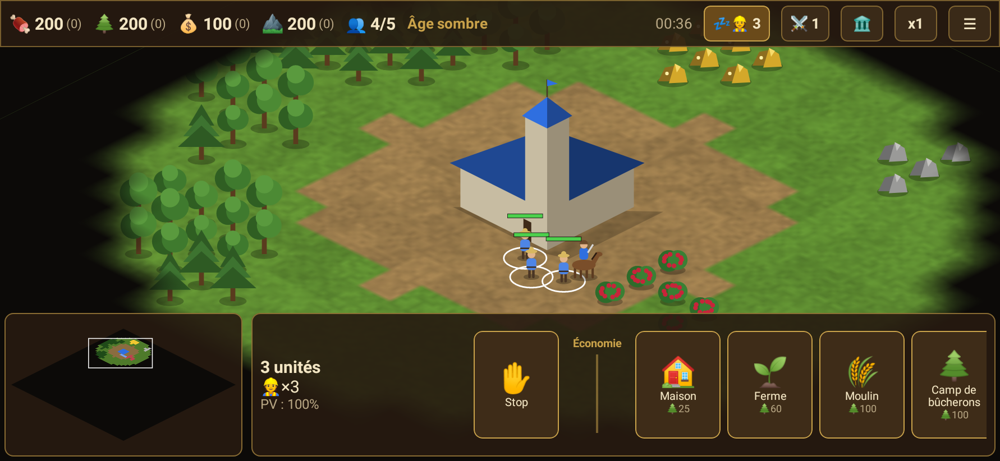

# Age of Android

Un jeu de stratégie en temps réel inspiré d'**Age of Empires II**, repensé pour le mobile (paysage, tactile).
100 % Kotlin + Jetpack Compose, aucun asset graphique : tout est dessiné de façon procédurale en vue isométrique.

| Menu | En jeu |
|---|---|
|  |  |

## Contenu

- **4 ressources** : nourriture (baies, fermes ressemées automatiquement), bois, or, pierre. Les villageois récoltent, portent 10 unités (15 avec la Brouette) et déposent au forum ou au camp le plus proche.
- **4 âges** : sombre → féodal → châteaux → impérial, avancés depuis le forum.
- **13 bâtiments** : forum, maison, moulin, camps de bûcherons/mineurs, ferme, caserne, camp de tir, écurie, forge, tour de guet, atelier de siège, merveille.
- **7 unités** avec un système de contres (armure de mêlée / perçante, bonus) : villageois, milicien, piquier (anti-cavalerie), archer, éclaireur, chevalier, bélier (anti-bâtiments).
- **9 technologies** (Brouette, Forgeage, Empennage, Armure d'écailles, Maçonnerie…).
- **4 civilisations** avec bonus : Francs, Bretons, Teutons, Japonais.
- **IA** (1 à 3 adversaires, 3 niveaux) : économie, maisons, camps près des ressources, passage des âges, vagues d'attaque, défense (y compris des villageois).
- Brouillard de guerre, mini-carte, file de production, point de ralliement, vitesse x1 à x3.
- **Sauvegarde** : automatique quand l'application passe en arrière-plan, à la pause et en quittant la partie, plus un bouton 💾 dans le menu pause. « Continuer » sur l'écran d'accueil reprend la partie (un seul emplacement ; une partie terminée est effacée).
- **Victoire** : détruire tous les ennemis, ou construire une Merveille et la garder 3 minutes.

## Contrôles tactiles

| Geste | Action |
|---|---|
| Toucher | Sélectionner une unité / un bâtiment |
| Appui long + glisser | Sélection de groupe (les militaires sont privilégiés) |
| Glisser / pincer | Déplacer la caméra / zoomer |
| Unités sélectionnées + toucher la carte | Ordre contextuel : déplacer, récolter, construire, attaquer (toucher un de vos bâtiments le sélectionne, sauf chantier ou ferme libre) |
| Bâtiment sélectionné + toucher la carte | Point de ralliement |
| 💤👷 / ⚔️ / 🏛️ | Villageois inactif suivant / toute l'armée / forum |
| ▼ / ▲ | Replier / déplier la barre du bas (mini-carte et actions) |

## Installer sur son téléphone

1. Ouvrez la page [Releases](https://github.com/ghostwan/AgeOfAndroid/releases) depuis le téléphone et téléchargez `AgeOfAndroid-vX.Y.Z.apk`.
2. Ouvrez le fichier : Android demande d'autoriser l'installation depuis le navigateur ou le gestionnaire de fichiers (*Installer des applis inconnues*). Acceptez.
3. Ou depuis un ordinateur : `adb install AgeOfAndroid-vX.Y.Z.apk`.

Toutes les builds (CI et locales) sont signées avec la même clé, `app/debug.keystore`, versionnée dans le dépôt : une nouvelle version s'installe par-dessus la précédente et garde la sauvegarde. Cette clé est publique, elle ne convient pas pour une publication sur le Play Store. Les versions antérieures à 0.3.2 utilisaient une clé aléatoire : il faut les désinstaller une dernière fois.

## Publier une release

Le workflow `.github/workflows/release.yml` (tag `v*`, push sur `master`/`claude/**`, ou lancement manuel) lance les tests, construit l'APK et publie la release `v<versionName>` avec l'APK attaché. Incrémentez `versionName` dans `app/build.gradle.kts` pour une nouvelle release.

```bash
git tag v0.1.0 && git push origin v0.1.0
```

## Développement

```bash
./gradlew :app:testDebugUnitTest   # moteur (JVM) + captures d'écran Robolectric dans app/build/screenshots
./gradlew :app:assembleDebug       # app/build/outputs/apk/debug/app-debug.apk
```

Architecture :

- `game/` : moteur pur Kotlin, testable sur la JVM. `World` (simulation, ordres, combat, brouillard), `GameMap` (grille + A*), `MapGenerator`, `AiPlayer`, `Types` (données d'équilibrage).
- `ui/` : Compose. `GameController` (caméra, sélection, entrées), `GameRenderer` (rendu isométrique sur Canvas : terrain et brouillard en textures pivotées à 45°), `Hud`, `GameScreen` (boucle `withFrameNanos` + gestes), `App` (menu).
